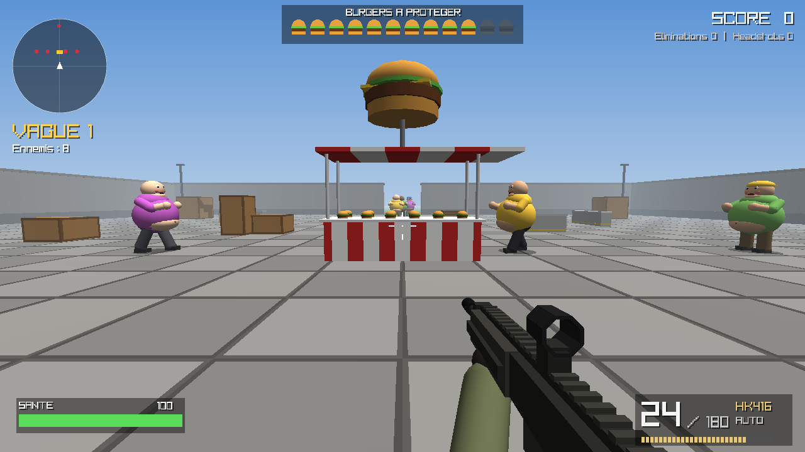
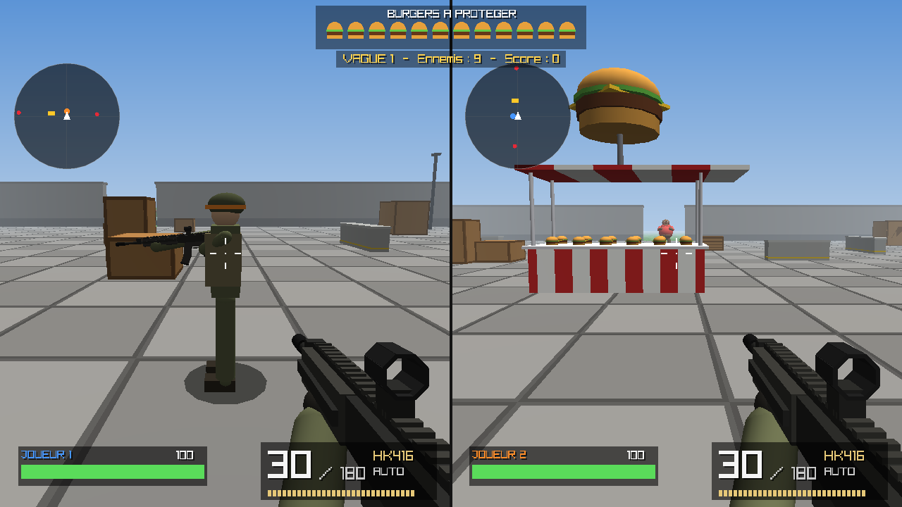
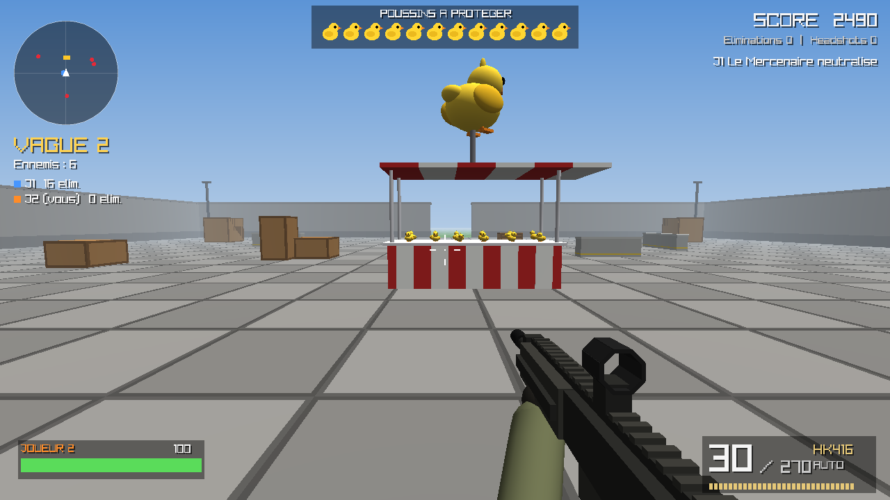

# 🐥 BURGER RUSH : Opération HK416

FPS en **C** avec **raylib**, jouable **seul**, **à deux sur le même PC** (écran partagé) ou **jusqu'à 4 en réseau**. Disponible pour **Windows**, **macOS (Apple Silicon)**, **Linux**, **Android** et **iOS**. Vous incarnez à la première personne un opérateur armé d'un **HK416** qui protège ses **poussins** contre des vagues de **mercenaires en treillis olive**, le visage peint en vert et les yeux cernés de noir, une **chaîne en métal** autour du cou, qui avancent comme des zombies, bras tendus, bien décidés à tous les enlever.



Tout est généré par le code (modèles 3D, sons, textures), sauf l'enregistrement du « Kyrie des gueux » (`assets/kyrie_des_gueux.ogg`), intégré directement dans l'exécutable par `scripts/embed_music.py` : **aucun fichier externe à fournir**.

**Ambiance** : la partie se joue **de nuit** (ciel étoilé, lune, lampadaires et lampe du stand qui éclairent l'arène). Les mercenaires lancent des « **On va croquer les poussins !** » (bulle au-dessus de la tête et voix grognée). En fond, le chant militaire **« Kyrie des gueux »** accompagné d'une **marche au tambour** générée par le code.

## 🎮 Le jeu

- Au centre de l'arène, **12 poussins** sautillent sur le comptoir du stand.
- Les mercenaires entrent par les **4 portes** de l'arène et foncent vers le comptoir pour attraper les poussins. Chaque poussin enlevé les rend **plus costauds et plus résistants**.
- Un mercenaire qui brandit un poussin met encore un instant à l'emporter : **abattez-le à temps et le poussin est sauvé**.
- Si vous vous approchez trop d'eux, ils vous attaquent.
- **Game over** si vous mourez **ou** si tous les poussins sont enlevés.
- Entre deux vagues : +2 poussins, +90 munitions, +25 PV.
- Les ennemis abattus lâchent parfois des **caisses de munitions** ou une **salade** (soin).

### Les ennemis

| Ennemi | Description |
|---|---|
| **Le Mercenaire** | L'ennemi de base : treillis olive aux manches retroussées, brassard orange taché de sang, épaulettes rouges, béret glissé sous l'épaulette ou foulard rouge et noir, visage peint (3 styles), chaîne autour du cou. |
| **L'Éclaireur** | Plus petit, rapide, foulard rouge et noir, et il vous fonce dessus en courant. Apparaît dès la vague 2. |
| **Le Colosse** | Énorme, lent, très résistant, chaîne en bandoulière en plus et cadenas. Dès la vague 3. |
| **LE CHEF DE GUERRE** | Boss géant au treillis plus sombre, béret sur la tête et cadenas doré, toutes les 5 vagues. |

### Le HK416

- Chargeur de 30 coups, ~850 coups/min, mode **auto / semi-auto**.
- Viseur **point rouge** (clic droit) : zoom, précision quasi parfaite.
- Recul, dispersion selon le mouvement, flash du canon qui éclaire la scène, traçantes.
- Rechargement animé (chargeur qui sort/rentre), plus long à vide (culasse).
- **Headshot = dégâts x3.**

### Le harpon

- Deuxième arme : **2**, **E** ou la molette (**1** pour revenir au HK416), **RB** à la manette, bouton **HARPON** sur mobile.
- Tire une flèche : le mercenaire touché **meurt en un coup et est projeté** à la renverse en tournoyant, la flèche plantée dans le ventre.
- En vol, il **percute les autres mercenaires** (gros dégâts, il peut même les faire décoller).
- 1 harpon chargé + 6 en réserve. +3 à chaque vague, +1 par caisse de munitions. 1,3 s pour recharger.

## 👥 Multijoueur

Au menu :

| Touche | Mode |
|---|---|
| **1** | Solo |
| **2** | Coop **écran partagé** : 2 joueurs sur le même PC |
| **3** | **Héberger** une partie réseau (jusqu'à 4 PC) |
| **4** | **Rejoindre** une partie réseau |

Dans tous les modes à plusieurs :

- Les mercenaires s'en prennent au joueur le plus proche ; ils sont plus nombreux (+50 % par joueur supplémentaire) et plus résistants.
- Un joueur à 0 PV est **à terre** et revient au début de la vague suivante.
- Game over si tous les joueurs sont à terre ou si tous les poussins sont enlevés.
- Le score est commun, les éliminations sont comptées par joueur. Chaque soldat porte une bande de couleur sur le casque (bleu, orange, vert, violet).

### Écran partagé

L'écran se coupe en deux, chaque joueur a sa vue, son HUD et son radar. Contrôles du joueur 2 plus bas.



### Réseau (plusieurs PC)

1. Sur un PC, appuyez sur **3** : l'écran affiche son **adresse IP** (par ex. `192.168.1.20`).
2. Sur les autres PC (3 maximum), appuyez sur **4**, tapez cette adresse puis **Entrée**.
3. Quand tout le monde est dans la salle d'attente, l'hôte appuie sur **Entrée**.

- Fonctionne entre Windows, macOS et Linux, sur le même réseau (Wi-Fi / box).
- Par Internet : l'hôte doit ouvrir le **port UDP 27016** sur sa box (redirection de port).
- Le pare-feu peut demander l'autorisation au premier lancement : acceptez.
- En réseau, **Échap** ouvre un menu mais **ne met pas la partie en pause** (Q pour quitter).
- Un joueur peut rejoindre une partie déjà commencée.



## ⌨️ Contrôles

| Touche | Action |
|---|---|
| ZQSD / WASD / flèches | Se déplacer (AZERTY et QWERTY supportés) |
| Souris | Viser |
| Clic gauche | Tirer |
| Clic droit | Viseur point rouge |
| R | Recharger |
| 1 / 2, E, molette | HK416 / harpon |
| B | Auto / semi-auto |
| Maj gauche | Sprint |
| Espace | Sauter (on peut monter sur les caisses) |
| Échap / P | Pause |

En solo, une manette fonctionne aussi (mêmes boutons que le joueur 2 ci-dessous).

### Joueur 2 (coop)

| Action | Manette | Clavier (sans manette) |
|---|---|---|
| Se déplacer | Stick gauche | I J K L |
| Viser | Stick droit | Flèches |
| Tirer | RT | Ctrl droit |
| Viseur point rouge | LT | Maj droite |
| Recharger | X / Carré | U |
| Harpon | RB / R1 | M |
| Sauter | A / Croix | O |
| Sprint | L3 | H |
| Mode de tir | Y / Triangle | N |
| Pause | Start | Échap / P |

Avec deux manettes, la deuxième peut aussi contrôler le joueur 1.

## ⬇️ Télécharger

### Windows

**[`release/BurgerRush.exe`](release/BurgerRush.exe)** : autonome (aucune DLL à installer), double-cliquez dessus.

> Windows SmartScreen peut afficher un avertissement car l'exe n'est pas signé : « Informations complémentaires » → « Exécuter quand même ».

### macOS (Apple Silicon : M1, M2, M3, M4…)

L'application est compilée automatiquement sur un Mac par GitHub Actions :

- après fusion sur `main` : **[page des releases → `BurgerRush-macOS-arm64.zip`](../../releases/latest)** ;
- sinon : onglet **Actions** → dernier run « Build » → section *Artifacts* → `BurgerRush-macOS-arm64`.

Dézippez puis lancez **BurgerRush.app**. L'application n'étant pas signée par un développeur Apple, macOS la bloque la première fois :

- **clic droit** sur `BurgerRush.app` → **Ouvrir** → **Ouvrir** ;
- ou, si macOS dit qu'elle est « endommagée », dans le Terminal : `xattr -dr com.apple.quarantine ~/Downloads/BurgerRush.app`

### Linux

Même endroit que pour macOS : `BurgerRush-linux-x64.tar.gz` (ou compilez, voir plus bas).

### Android

`BurgerRush-android.apk`, sur la [page des releases](../../releases/latest) (ou *Artifacts* du dernier run « Build »).
Ouvrez-le sur le téléphone et autorisez l'installation d'applications de source inconnue quand Android le demande.

### iOS (iPhone / iPad)

`BurgerRush-iOS.ipa`, même endroit. Apple n'autorise pas l'installation directe d'une app non signée :
installez-la avec **[Sideloadly](https://sideloadly.io)** ou **[AltStore](https://altstore.io)** (gratuits, avec votre identifiant Apple).
Elle doit alors être réinstallée tous les 7 jours (limite Apple pour les comptes gratuits).

## 📱 Contrôles tactiles

| Zone | Action |
|---|---|
| Moitié gauche | Joystick (il apparaît sous le doigt). Poussé à fond vers l'avant : sprint |
| Moitié droite | Glisser pour viser |
| **FEU** | Tirer (on peut aussi viser en glissant le doigt dessus) |
| **VISER** | Viseur point rouge (appui = activer / désactiver) |
| **SAUT**, **RECH.**, **HARPON** | Sauter, recharger, changer d'arme |
| **II** | Pause |

Le multijoueur réseau marche aussi sur téléphone (même Wi-Fi) ; l'écran partagé est réservé au PC.
Une manette Bluetooth fonctionne aussi.

## 🗂️ Organisation du code

| Fichier | Rôle |
|---|---|
| `src/main.c` | Point d'entrée, fenêtre, boucle principale |
| `src/game.c` | États du jeu (titre, salle d'attente, partie, pause, game over) et écran partagé |
| `src/net.c` | Multijoueur réseau : l'hôte simule la partie et envoie l'état du monde, chaque client gère son joueur et envoie ses tirs |
| `src/netsock.c` | Sockets UDP pour Windows, macOS et Linux |
| `src/player.c` | Commandes (clavier/souris, manette, 2ᵉ clavier), déplacements, vie, caméra, modèle du coéquipier |
| `src/weapon.c` | HK416 : tir, recul, rechargement, modèle 3D et mains |
| `src/enemy.c` | Mercenaires : apparition, IA, dégâts |
| `src/enemymodel.c` | Modèle 3D des mercenaires : treillis, visage peint, brassard, chaînes (un seul mesh généré par carrure), démarche de zombie |
| `src/waves.c` | Enchaînement des vagues et récompenses |
| `src/pickup.c` | Bonus (munitions, salade) |
| `src/map.c` | Arène, stand des poussins, collisions |
| `src/harpoon.c` | Flèches du harpon (projectiles) |
| `src/effects.c` | Particules et traçantes |
| `src/hud.c` | Interface 2D et écrans |
| `src/ui.c` | Échelle de l'interface et boutons (souris / doigt) |
| `src/touch.c` | Contrôles tactiles (mobile) |
| `src/render.c` | Shader (dont l'usure du treillis) et primitives 3D (cube, sphère, cylindre), poussin |
| `src/audio.c` | Sons générés par le code |
| `src/config.h` | Toutes les constantes de réglage (vitesses, dégâts, munitions…) |

## 🔧 Compilation

Nécessite **raylib 5.5**.

### Avec CMake (le plus simple, télécharge raylib automatiquement si besoin)

```bash
cmake -B build
cmake --build build
./build/burger_rush
```

### Avec make (raylib déjà installée)

```bash
make
./burger_rush
```

Si raylib est compilée depuis les sources dans un dossier :

```bash
make RAYLIB_PATH=/chemin/vers/raylib
```

Pour régénérer l'exe Windows depuis Linux (MinGW + raylib compilée pour Windows) :

```bash
make windows RAYLIB_WIN_PATH=/chemin/vers/raylib-windows
```

### Mobile

- **Android** : `scripts/build_android.sh` (NDK + SDK Android, sans Gradle).
- **iOS** (sur un Mac avec Xcode) : `scripts/build_ios.sh device` ou `simulator`. raylib n'ayant pas de version iOS officielle, le jeu utilise son backend **SDL2**.
- Pour tester l'interface tactile sur PC : `BR_TOUCH=1 ./burger_rush` (la souris joue le rôle du doigt).

Le workflow [`.github/workflows/build.yml`](.github/workflows/build.yml) compile automatiquement les 5 versions à chaque pull request. Il lance aussi le jeu dans un émulateur Android et un simulateur iOS, dont les captures sont publiées sur la branche `ci-captures`.

Sous Linux, les dépendances de raylib sont : `libx11-dev libxcursor-dev libxrandr-dev libxinerama-dev libxi-dev libgl1-mesa-dev`.
